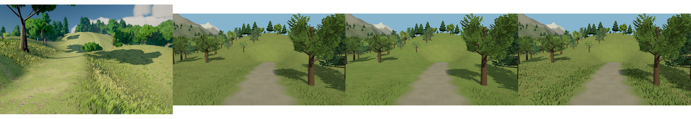
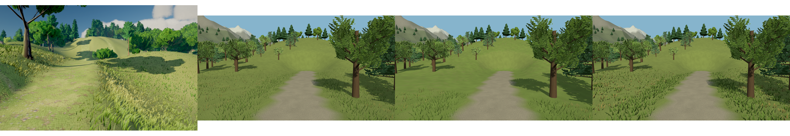

# プロシージャル環境描画の比較実験

## 実施範囲と完了状態

**指示23全体は未完了。Phase Aの比較方式を実装し、検証を進めた段階である。**
樹木の生成規則・影モデル比較（Phase B）、住宅の建築規則と3種類の材質比較（Phase C）、採用方式の共通基盤への統合と全視点の比較（Phase D）は今回の変更には含めていない。
草の診断用比較方式を標準品質として採用したわけではなく、通常描画は従来のA0を維持する。

開始時HEADは `c044b914d48628c3136b1b156421da3b744d58c6`。
作業ブランチは `feat/procedural-environment-rendering`。
開始時の未コミット変更は利用者の `指示23.md` だけであり、その内容を保持した。

## 再利用した基盤と責務

- Asset Factory、Asset Pipeline、Asset Catalog、WorldBuildManifestを維持した。既存GLB、共有テクスチャ、樹木LOD、住宅14棟、Collider、ワールドのSeedと生成バージョンは変更していない。
- 既存のManifestは生成バージョン、Seed、World fingerprint、Catalog fingerprint、素材のcontentHashとmetadataHashを保持する。今回の草実験は保存素材を更新しないためManifestの拡張は行っていない。将来、樹木・住宅を再生成するときは既存Pipelineを通して新しい内容ハッシュを反映する必要がある。
- `world-generator/vegetation.ts` は絶対座標セルとSeedによる配置を担当する。既存の道路から6m以上離れたセルを22%間引く判定を `vegetationCoverage` へ分離し、草配置とA1の地表マスクで共用した。
- `world-vegetation.ts` はWorld Designの道路・建物・水面・傾斜・農地・広場などの除外条件を接続する。A1にも同じ判定を渡す。
- `vegetation.ts` は既存の16m草パッチとInstancedMesh、共有Geometry／Material、画面上の草丈によるLODとヒステリシスを維持する。
- `grass-ground.ts` は地表材質の既存シェーダーを拡張する。128×128 RGBAマスクはA1を有効にしたChunkだけで作り、Chunk解放時に破棄する。1枚あたりCPU画素配列は65,536 bytesで、GPUもRGBA8なら同量を要する。初回作成時間と所有バイト数は診断値へ追加した。
- 草は物理Entityを生成しない。草の影を投げない既存設定を維持し、地表と草が影を受ける設定を維持した。樹木の影や既存の物理処理は変更していない。

生成と描画の責務は既存の境界を使う。樹木・住宅のオフライン生成方式自体の新しい実装や、事前生成テクスチャとの比較は未実施である。

## 比較方式

| 方式 | 地表                                     | 草の立体表現                                    | 追加負担                                               |
| ---- | ---------------------------------------- | ----------------------------------------------- | ------------------------------------------------------ |
| A0   | 従来の地表材質                           | 従来の8葉／3葉LOD                               | 基準                                                   |
| A1   | 共通被覆判定のマスクと絶対座標の周期模様 | カメラから26mで表示、30mで非表示となる近景草    | Chunkごとのマスク作成・保有・Texture参照               |
| A2   | 従来の地表材質                           | 葉幅を2.8倍にした同数の葉＋頂点シェーダーの揺れ | 幅広葉の画面占有面積、別の共有Material、比較用Geometry |

A1・A2とも同じ候補株、同じSeed、同じ配置・回転・縮尺・色を使う。A1では配置済みの株を距離で非表示にするため、配置配列やInstance bufferの容量は減らない。
A2は三角形数を増やさないが、ラスタライズする画素が増える。三角形数が同じでも描画負荷が同じとは限らない。
A2の揺れは時間・草丈・絶対座標とSeedから決まった回転の位相を使う。JavaScriptで草頂点を毎フレーム更新しない。

診断APIの `setEnvironmentDiagnostics({ grassMode: "A0" | "A1" | "A2" })` で切り替える。
Project Schemaには設定を追加していない。後から読み込まれたChunkにもRendererのLOD更新で同じ診断モードを適用する。
A1を解除すると地表材質の元のコンパイル処理とプログラムキーへ戻る。実験で作ったマスクはChunk解放まで保有する。

## Streaming・Origin Rebase・解放

草の候補セルは絶対座標と半開区間のChunk境界で決める。負座標も既存の `floor` による生成方式を維持する。
草はChunkの子として移動し、Instance matrixを書き直さず既存のOrigin Rebaseに追従する。
A1のマスクUVは元のChunk局所座標を使い、色模様の位相は生成時の絶対原点を周期で縮めて渡すため、親Chunkの移動では模様がずれない。
A2の揺れの位相はRebaseで変化しないInstance matrixの回転から取得する。
幅広葉と揺れの変位を含めるため、A2のカリング用Bounding sphereに0.35mの余裕を設ける。A0のBounding sphereは変更しない。
共有草GeometryとMaterialは最後のChunk解放時に破棄する。マスクTextureは所有Chunkの解放時に破棄する。解放処理は二重呼び出しに対応する。

マスクは有限解像度であるため、道路・建物などの除外境界をTextureの補間でぼかす。隣接Chunkのマスク端の補間の完全一致や、非同期World切り替えを新方式で反復したブラウザ長時間検証は未達成である。

## 撮影と測定条件

実Studio、Alpine Village、Seed 42、Viewport 1440×1000、描画キャンバス1440×771、垂直FOV 45°、Pixel Ratio 1、MSAA 4 samples、既存の同一カメラ設定を使用した。
森林の小道は位置 `[72, 16, -137]`、注視点 `[122, 16, -153]` を既存のInspection APIに渡す。
実際のカメラはOrbitControlsの角度制限による補正を受け、位置は `[72.098664, 19.296353, -137.031572]`、注視点は `[122, 16, -153]` となる。6条件で実カメラ位置と注視点が一致し、World sourceのSHA-256も `6dcc7c284f4ea0820b3205ec74f46908218d270b18a565df87b05e1793267ecf` で一致した。条件の詳細は各 `validation.json` と `performance.json` を参照する。A0も比較診断を有効にするため、通常モードだけを動かす基準コミットのCPU経路と完全に同一ではない。全比較方式で共通の診断処理を使う。
各方式でStreamingの安定を待ち、10秒×3回を測定した。実際に読み込んだWorldのSeed、生成バージョン、World sourceのSHA-256を測定データに保存する。描画フレーム番号で重複を除き、nearest-rankで中央値とp95を集計する。
診断モードを明示した測定ではカテゴリ除外の追加診断を省き、全方式で影を有効にしたまま測る。CPUの `renderMs` は描画命令の投入時間であり、GPU完了までの総時間ではない。`rafMs` を併記して判断する。
既存の過去の383.3ms等は今回の改修前の測定値として使っていない。

正式な証跡は成功済みのPlaywright出力を専用スクリプトで明示的に保存した。通常のテストでは正式証跡を更新しない。



左から参考画像、A0、A1、A2。参考画像とは地形、木の配置、カメラ、照明が異なる。参考画像を3D背景として使用していない。

### 測定APIの修正と初回データの扱い

Agent APIは当初、フレーム時間とCPU描画時間に `recentSpikes.at(-1)` を使っていた。これは最新フレームではなく、最後に記録された遅いフレームである。実GPUで600近いフレームを10秒間に採取できているのに、同じ33msや83msが長く続くことから問題を確認した。
Engineの `latestFrameTiming` に実際の直近フレームのRAF間隔・CPU作業・物理・描画時間を公開し、Agent APIをその値へ接続した。値がないホストはnullを返し、過去のSpikeで埋めない。この診断変更は物理・描画アルゴリズムを変更しない。

[初回データの注意書き](procedural-rendering/invalid-spike-timing/README.md)に従い、修正前のCPU描画時間とフレーム時間の中央値・p95を方式選択に使用しない。画像・Draw Calls・Trianglesにはこの問題は影響しない。
初回A1はDraw Calls 273→257、Triangles 424,067→396,572となり、可視草パッチが22→6へ減った。しかしフレーム時間の改善はこの初回データから判断できない。A2は草の総数121,033、可視パッチ22、三角形数を維持した。
初回A1のChunk位相の共有プログラム上の問題も修正し、原点・サイズ・Seedを材質ごとのUniformへ変更した。最終比較はこの修正後のコードで実施する。

### SwiftShaderの最終結果

| 方式 | Draw Calls | Triangles | CPU描画中央値 | GPUクエリ中央値 | フレーム中央値 | フレームp95 | GPU登録Texture数 |
| ---- | ---------: | --------: | ------------: | --------------: | -------------: | ----------: | ---------------: |
| A0   |        273 |   424,067 |        6.50ms |       357.854ms |        366.7ms |     383.4ms |                6 |
| A1   |        257 |   396,572 |        5.80ms |       343.544ms |        350.0ms |     400.0ms |               32 |
| A2   |        273 |   424,067 |        6.10ms |       354.125ms |        366.6ms |     383.4ms |                6 |

### 実GPUの最終結果

利用可能なGPUはNVIDIA GeForce RTX 4090、`nvidia-smi` のドライバー表記は528.24。
WSLでは通常のOpenGL指定はllvmpipeだったため、`GALLIUM_DRIVER=d3d12` と `MESA_D3D12_DEFAULT_ADAPTER_NAME=NVIDIA` を指定する。
ブラウザが返す `ANGLE (Microsoft Corporation, D3D12 (NVIDIA GeForce RTX 4090), OpenGL 4.6)` を確認した場合だけ実GPUの正式証跡として受け付ける。SwiftShaderやllvmpipeのGPUクエリ値をRTX 4090の値として扱わない。

| 方式 | Draw Calls | Triangles | CPU描画中央値 | GPUクエリ中央値 | フレーム中央値 | フレームp95 | GPU登録Texture数 |
| ---- | ---------: | --------: | ------------: | --------------: | -------------: | ----------: | ---------------: |
| A0   |        273 |   424,067 |        4.00ms |         0.177ms |         16.7ms |      16.8ms |                6 |
| A1   |        257 |   396,572 |        4.30ms |         0.171ms |         16.7ms |      16.8ms |               30 |
| A2   |        273 |   424,067 |        4.20ms |         0.177ms |         16.7ms |      16.8ms |                6 |



SwiftShaderではA1のフレーム中央値が約4.6%減ったが、p95は約4.3%増えた。RTX 4090では全方式が中央値16.7ms、p95 16.8msであり、測定した表示間隔に改善はない。GPUクエリの微小差から一般的な高速化とは判断しない。各窓の中央値とp95は[比較JSON](procedural-rendering/comparison.json)に保存した。

A1は90枚のマスクを所有し、CPU画素配列が5,898,240 bytes（5.625MiB）増えた。初回マスク作成の累計CPU時間はSwiftShaderで1,280.1ms、RTX 4090で974.2ms。Sceneの所有Texture数は18→108、描画時のGPU登録Texture数はSwiftShaderで6→32、RTX 4090で6→30となった。GPU登録数の差は実際に利用されたTextureと登録のタイミングによるもので、所有数90枚は共通である。全方式でMaterial参照数250、Geometry参照数252、草の総数121,033、総パッチ数1,026だった。

Navigation開始からRuntime HUD表示までの時間はA0/A1/A2で 3237/3339/2976ms、実GPUで 3329/3357/4447msだった。マスク作成はHUD表示後に行うため、この起動指標には含まれない。

### 測定の制約

サマリーにはHeapの3回のスナップショット、Geometry／Material／Texture数、Streamingの投入・Commit時間を保存する。HeapはGCの影響があるため単一のピークから方式の優劣を判断しない。
Renderer Texture数はGPUへ実際に登録された数、resources.texturesはシーンが所有している素材の参照数であり異なる。初回のリソース走査はA1のシェーダー用Textureを含めていなかったが、現在はMaterialのuserDataに保持するTextureも数える。
ブラウザのChunk生成時間は既存Agent stateから取得できず、nullで記録する。loadingスナップショットから起動時間を推測しない。Navigation開始からRuntime HUD表示までの時間は測定するが、全地形やLODが準備できるまでの時間とは異なる。
GPUクエリには非同期の取得遅れがあり、Agentは直近に回収した値を返す。各描画フレームと完全に同じフレームのGPU値とは保証しない。採用判断には実際のRAF間隔も使う。

### 生成時間と素材容量

Node v22.21.0、1回ウォームアップ後、100 Chunk×3回の生成時間は中央値8.11ms、p95 25.33ms。
平坦地・制限なしの128m Chunkの草配置は3回の中央値12.01ms。実Worldの地形・道路・建物の判定コストは含まない。
8葉と3葉のGeometryを1組作成した時間はA0中央値0.155ms、A2中央値0.081ms。各3回しか測っておらず、この微小差を高速化の証拠と扱わない。
既存9 Sample Worldの素材ファイル総容量は6,960,334 bytes。草の診断方式は新しいGLBや保存Textureを追加しないため、この容量は方式間で同じである。
Nodeの生成測定はブラウザの読み込み・準備時間、描画時間と分けて `test-results/procedural-measure/generation.json` に保存した。

## 視覚品質と採用判断

A1は中景の立体草が消え、草と平面的な地表の境目が目立った。色の模様だけでは参考画像の道路脇の密生を再現できていない。準備時間・保有メモリが増え、実GPUの表示間隔も改善しないため、現段階では標準方式として不採用。
A2は同じ株数で地表の被覆が増えるが、幅広い三角形が目立ち、参考画像の細長い草葉の自然さとは異なる。現段階では標準方式として不採用。
A0を標準に維持し、A1/A2は比較用の診断モードとして残す。最軽量という理由だけでA1を選ばない。
地表の被覆量の改善と、自然な草地の完成は同じではない。草地の最終的な視覚品質改善は未達成である。

## テスト結果

- TypecheckとLint（循環依存検出を含む）は成功。
- Unit／Integrationは53ファイル・401テスト成功。再実行の前には、既存 `streaming-frame-budget.test.ts` の50ms実時間予算を使うテストが1件失敗した。ブラウザ測定を止めた再実行で全件成功した。失敗の履歴も残す。
- 新規の草4テストは葉幅変更の頂点数・草丈、配置維持、Rebase、方式切り替え、共有Geometry／Materialの解放、A1マスクの除外条件、元シェーダーへの復帰、Textureの二重解放防止、Chunk間のプログラム共有とUniform分離を検証する。Agent APIの追加テストは、過去のSpikeではなく最新フレームの測定値を返すことを検証する。
- Buildはブラウザ撮影のwebServer準備として `pnpm build` を実行して成功した。
- `pnpm sample-worlds:prepare` と `pnpm sample-worlds:validate` は成功。生成後に既存の素材・Worldファイルの差分は発生していない。
- 実StudioのSwiftShader撮影はA0/A1/A2とも成功。シェーダーエラー、ブラウザ例外、GLB読込エラーがないことを確認した。
- 最終版の全E2Eは50件すべて成功（20.8分）。9ワールドのfresh data起動、車・飛行機・ボート・VFX、長距離飛行とRebase、物理Streaming、圧縮LOD素材と非Box Colliderを確認した。通常E2Eが既存の正式画像・診断JSONへ書き込んだ生成物は `test-results/procedural-checks/generated-evidence/` に保存してから、既存資料の差分を戻した。

## 再実行方法

```bash
PLAYWRIGHT_BROWSERS_PATH=/home/smorce/.cache/ms-playwright \
FIDELITY_CAPTURE=1 QUALITY_PHASE=phase1 PROCEDURAL_GRASS_MODE=A2 \
pnpm exec playwright test tests/e2e/environment-quality.spec.ts \
  --output=test-results/procedural-A2

# 正式な証跡の更新は通常テストと分離して明示実行する。
pnpm exec tsx scripts/procedural-rendering-evidence.ts A2 test-results/procedural-A2
pnpm exec tsx scripts/procedural-rendering-measure.ts
```

A0/A1も `PROCEDURAL_GRASS_MODE` を変更して同じ条件で実行する。実GPUは既存の `playwright.environment.config.ts` と `GEOMETRY_GPU_CAPTURE=1` を使う。

## 残る必須作業

- Phase Aの草葉の自然さ、A1の密度分布と移行境界、Chunk端のマスク補間、大座標での視覚的連続性の追加検証。
- カメラ周辺だけに必要なInstance bufferを準備して配置メモリも削減する方式との比較。
- Phase Bの樹冠生成規則の高度化、同じSeedによるLOD輪郭の整合、GLB事前生成、4種類の影方式の比較。
- Phase Cの代表住宅の建築規則、上階張り出し、Collider整合、共有Texture／保存したコード生成Texture／実行時シェーダーの3方式比較。
- Phase Dの採用方式統合、既存品質設定への接続、村・農地・森林・全景の同条件の改修前後撮影。
- 新方式でのWorld切り替え、再読込、非同期Chunk取消、繰り返し解放の長時間ブラウザ検証。
- 完全な初回準備時間と新方式のChunk準備時間の測定。森林以外の3視点も含む基準コミットとの現在環境での再比較。

以上が残っているため、指示23の最終完了条件を満たしたとは扱わない。
