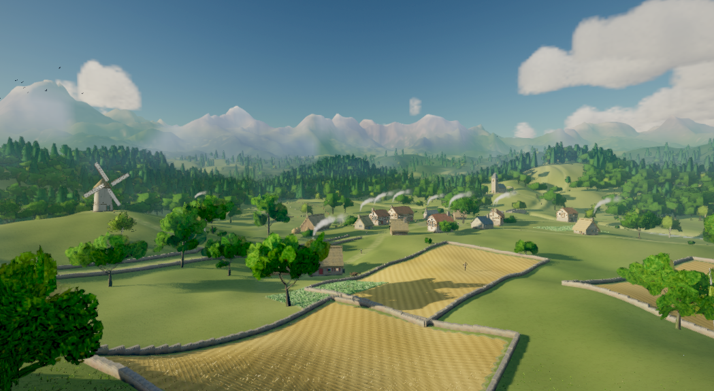
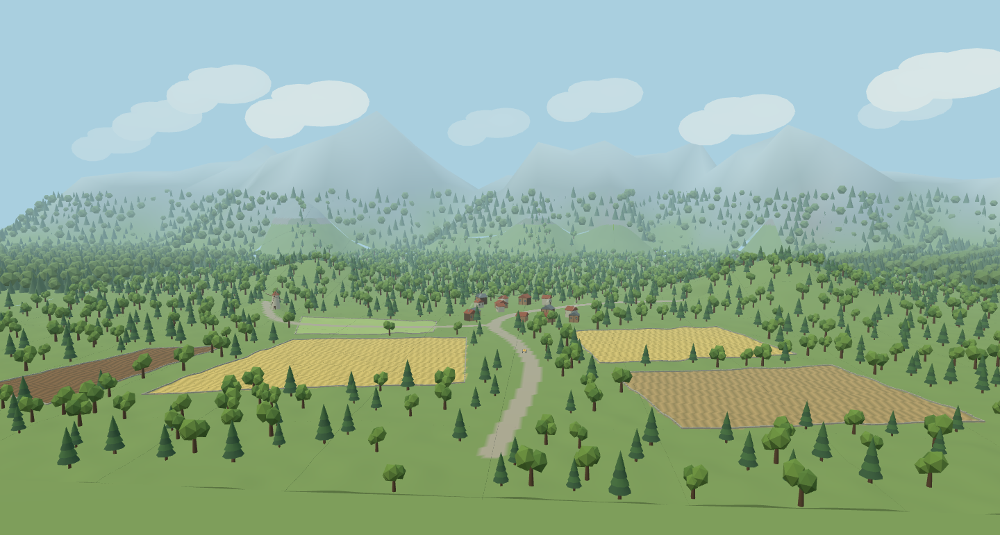

# Alpine Village（アルプスの村）実装報告

## 作業基準と起動方法

`feat/renderer-flight-vfx` の指定コミット `fa71e23` から、独立ブランチ `feat/alpine-village-world` に実装した。既存8ワールドのPrepared JSONは変更していない。`tests/fixtures/pre-alpine-worlds.json` のSHA-256比較と、既存3Presetの生成出力の回帰テストで確認する。

Studioのサンプルワールド一覧から **🌾 Alpine Village（アルプスの村）** を選び、「▶ あそぶ」を押す。推奨Machineは既存のStarter Car。開始位置は道路沿いの `[6, 14, 60]`。W／↑で前進、A／Dで方向を変え、Rで開始位置へ戻る。World／Machine／Playerは従来のProject Modelを使用し、専用の別エンジンを必要としない。

```bash
pnpm sample-worlds:prepare
pnpm sample-worlds:validate
pnpm dev
```

## 景観の実装

| 要素       | 実装                                                                                                                                                                                                                 |
| ---------- | -------------------------------------------------------------------------------------------------------------------------------------------------------------------------------------------------------------------- |
| 地形と山脈 | World Designの半径1,600mの陸地を再利用し、活動範囲を内陸に置いた。海は無効。13の主峰と2つの丘を配置。Alpine専用の山に角度ごとの稜線変化を加え、丸い丘との差を付けた。遠景もSemantic Layersで生成する3Dメッシュ。     |
| 森林       | 針葉樹と広葉樹の2Slot。道路・建物・農地・風車の周囲を空け、高さ・回転・密度に変化を付けた。近景は既存の決定的配置とInstancedMesh。遠景は低解像度の樹冠群を2バッチで描画し、近景Chunkが読み込まれた場所から除外する。 |
| 村         | 中心 `[0,12,-83]`、半径57m。Settlement生成を使い、石造5棟、木造5棟、納屋4棟の計14棟。切妻屋根、窓、木枠、扉、軒、煙突を造形。屋根は赤茶・灰色の2色。道路と建物の間隔を確保する。                                     |
| 道路       | 既存Catmull–Rom道路と地形の高さ補正。村へ続く9m幅の道と、風車へ続く7m幅の支道。車両力計算とRapierには変更を加えていない。                                                                                            |
| 農地       | 不規則な四角形・台形の5区画。麦2区画、草地、収穫跡、土の畑。地形頂点の色で畝と刈り跡を表し、近い麦畑に立体的な穂を配置する。タイルは絶対座標4m格子で所有Chunkを決定する。                                            |
| 石垣       | 区画の輪郭に沿う672区間の低い石積み。3列の異なる石の位置と高さを変え、各区間を地形へスナップ。道路端から2.3m未満になる区間は設けず、道路への侵入を避ける。                                                           |
| 風車       | 村の左側 `[-205,0,-65]`。先細りの石造塔、屋根、入口、4枚の格子状羽根。羽根だけを局所ピボットの周りで0.08rad/s回す。GLBの名前付きノードを描画側で扱い、力・ジョイントは追加しない。                                   |
| 煙         | 石造・木造の家から、控えめな白い煙が上昇・横流れ・縮小する。Chunk内の相対位置を使う描画専用InstancedMesh。                                                                                                           |
| 空と霞     | 青空、10群・60個の丸い雲のまとまり、密度0.0008の既存FogExp2。遠くの山は淡い青灰色。Alpineだけ地形頂点色をsRGBから線形RGBへ変換し、地面が白く飽和する問題を修正した。                                                 |

農地の形は `packages/world-generator/src/alpine-farmland.ts`、World Designは `packages/sample-worlds/src/alpine-village.ts` に分離した。島を無限の内陸地形に変更したわけではなく、推奨活動範囲は村から約320m、山麓を含む陸地の外周は約1.6kmにある。

## 素材とライセンス

外部素材・外部画像・生成サービスは使用していない。参考画像は構図の比較だけに使い、ワールドのテクスチャには取り込んでいない。

すべての追加モデルは `packages/ai-dummy/src/alpine-models.ts` がThree.js Geometryから生成するプロジェクト所有の素材（`project-owned`）。既存のオフラインAssetFactoryを使うため取得Providerの内部名とAIメタデータは `dummy-astra` / `dummy` のままだが、一般的な仮素材ではなく、今回の景観用の造形を実装している。Preparedの素材名と出典には実際のコードの位置を記録した。新たな外部ライセンス条項は追加していない。

モデルの単位はm、Yが上方向、原点は接地位置、家・風車の正面はローカル+Z。頂点色を使ってGeometryを1素材へ統合し、テクスチャは使わない。風車は塔と回転する羽根の2ノードを同じ1素材で描く。既存Asset PipelineでMeshopt圧縮、Bounds、Convex Hull、LODを生成する。建物・石垣・樹木の接触判定は既存のAsset Collider経路を使う。麦も既存経路の小さなColliderを持つため、畑の中は専用走行路として調整していない。

小さい穂や独立した石は自動Simplifyで十分に減らないため、`alpine-prepare.ts` で専用の低解像度モデルを作り、同じRuntime Pipelineを通す。60m・150mのLODとして登録し、既存のヒステリシス付きLOD切替を使用する。

| Slot                               | 近景の三角形数 | 最遠LODの三角形数 | 内容                       |
| ---------------------------------- | -------------: | ----------------: | -------------------------- |
| `building.alpine-village.stone`    |            200 |               200 | 石造り、窓、煙突、切妻屋根 |
| `building.alpine-village.timber`   |            236 |               236 | 木枠付きの家               |
| `building.alpine-village.barn`     |            200 |               200 | 大きな扉の納屋             |
| `landmark.alpine-village.windmill` |            644 |               604 | 石造塔と回転する格子羽根   |
| `landscape.alpine-village.wall`    |            300 |                12 | 近景の石積みと遠景の低い壁 |
| `landscape.alpine-village.wheat`   |            416 |                26 | 4mタイル内の穂             |
| `nature.tree.alpine-village.oak`   |            588 |                88 | 複数の樹冠を持つ広葉樹     |
| `nature.tree.alpine-village.pine`  |             92 |                78 | 段のある針葉樹             |

マテリアル数、Runtime容量、Bounds、各LODファイル、実際の三角形数は添付の `performance-summary.json` の `assetMeasurements` を参照する。金属度は0、粗さは1。GLB、Collider、サムネイル、LODは `demos/sample-worlds/assets/` に内容ハッシュで保存し、`library.json` とWorldBuildManifestから参照する。

## アーキテクチャ・Chunk・Origin Rebase

Schemaの変更はない。Worldの識別子は `alpine-village`、地形は既存の `designed-world` を使う。AlpineのChunkは64m、解像度33×33。`worldChunkSize()` とSourceのサイズが一致する。render／physicsのChunk範囲、Worker、参照管理、生成予算、Origin Rebaseの閾値と仕様は既存のまま。

村・道路・森林・石垣にはWorld Design／Semantic Layers／Settlement生成／Catalog解決を再利用した。作物もChunkで必要な分だけ生成し、ChunkごとにAsset IDでまとめて描く。全近景オブジェクトを起動時に作る方式にはしていない。遠景地形・樹冠と少数の雲だけは全景用の簡略表現として保持する。

高解像度Chunkと粗い遠景Proxyの辺の高さ差で空が見える隙間は、Alpineの描画メッシュの辺を地面より下に延長して隠す。地面より上の高さと法線、PhysicsのHeightfieldは変更せず、Draw Callも増やさない。

TerrainとInstanceは既存のChunk-local座標を使う。煙も同じChunkを親に持ち、羽根の回転もInstanceの局所行列に適用する。雲と遠景Proxyは絶対座標から `worldOrigin` を引いて配置する。LOD中心は既存の `shiftOrigin()` で移動する。

Chunk解放時に煙の更新集合から除外し、Geometry／Material／InstancedMeshを解放する。モデルは既存の参照数付きAssetTemplatesを共有し、最後の利用者が解放すると素材も解放する。遠景樹冠はFarWorldProxyのdisposeでInstanceと素材を解放する。Worldの再読込は従来のload／disposeを通す。

低FPSで一般Render Commitが連続して省略されると、地形だけを先に描画したChunkにPropが追加されない問題をブラウザで確認した。AlpineのChunk生成コールバックだけで、Worker準備済みの結果を既存の `getChunk()` 経路でCatalog解決してから描画する。未準備データには呼び出さず、既存ChunkStreamerのcreate予算内で処理する。同期の地形生成を追加しない回帰テストを設けた。

観測APIに `setInspectionView(position,target)` と `getRenderedEntityPosition(entityId)` を追加した。前者はブラウザ検証用に絶対座標のカメラを設定し、追従を一時的に止める。新規ロードで通常の追従に戻る。後者は実際に描画されたInstanceの絶対位置を返す。サンプルの通常操作に新しいUIは追加していない。

## 検証方法

専用テストでCatalog、Schema、Manifestと必須Slot、Seedの再現性、逆順Chunk読込、14棟の配置、道路の連続性と石垣のクリアランス、Spawnの高さ、Origin Rebase後の絶対位置、再読込、煙・雲の解放、専用LOD、風車の回転ピボット、既存8ワールドのハッシュを確認する。

ブラウザでは本番ビルドのStudioをPlaywrightで起動し、Starter GrasslandとAlpine Villageを同一Chromium・同一1440×1000ビューポート・DPR 1で測定する。全景／村／畑／空撮／風車／森林に同じカメラ位置を設定し、初期接地後と走行中も記録する。実際のW入力で移動距離を検査し、再ロード後も描画する。風車が実際の描画Instanceとして存在することを待ってから撮影する。

```bash
pnpm typecheck
pnpm lint
pnpm test --maxWorkers=2
pnpm build
pnpm sample-worlds:prepare
pnpm sample-worlds:validate
PLAYWRIGHT_BROWSERS_PATH=/home/smorce/.cache/ms-playwright pnpm test:e2e
# Alpineだけを別Portで再撮影する場合
PLAYWRIGHT_BROWSERS_PATH=/home/smorce/.cache/ms-playwright pnpm exec playwright test --config playwright.alpine.config.ts --grep 'Alpine Village:|alpine-village: fresh'
pnpm exec tsx scripts/alpine-village-evidence.ts
```

通常の新規スクリーンショットと測定JSONはPlaywrightの `test-results/` 配下へ保存する。本報告書の画像とJSONは、正式な初回証跡として必要なファイルだけをコピーする。既存の別ワールドや飛行VFXのドキュメント証跡は更新しない。`sample-worlds:prepare/validate` も通常は `test-results/sample-world-validation.json` に出力し、正式更新は `UPDATE_WORLD_EVIDENCE=1` の場合だけ行う。

## ブラウザ画像と参考画像の比較

| 参考画像                                                    | 実際のStudio全景                           |
| ----------------------------------------------------------- | ------------------------------------------ |
|  |  |

参考画像はユーザー提供のローカルファイル。元のファイルを移動・変更していない。比較はカメラを南側の高い位置に置き、農地から北側の村・山脈を見る構図で行った。ピクセル一致や数値の類似率は測定していない。

| 評価点   | 観察結果                                                                                                   |
| -------- | ---------------------------------------------------------------------------------------------------------- |
| 山脈     | 横方向に続く複数の峰を再現。初回の丸い山を稜線のある形へ変更し、村から距離を取った。                       |
| 森       | 村の背後に広い森林を設け、近景に針葉樹と広葉樹を混在。遠景は簡略化した樹冠。参考画像より形の単純化が強い。 |
| 村       | 14棟が中央にまとまり、道路で農地へつながる。家の大きさを木より小さく抑えた。                               |
| 畑・石垣 | 黄色と緑・収穫跡・土の区画、畝の方向、低い区画境界を確認。近景の穂は参考画像の細かな麦より粗い。           |
| 風車     | 村の左に配置。専用近景も撮影し、格子羽根と石造塔を確認する。                                               |
| 空・色   | 大きな雲、青空、緑と黄の配色、青灰色の霞。写実的な雲のテクスチャや積雲の陰影までは再現しない。             |
| 奥行き   | 農地→村と木→森→山脈の順に距離帯を分けた。固定カメラの背景画像は使っていない。                              |

[村](alpine-village/village.png)・[農地](alpine-village/farmland.png)・[空撮](alpine-village/aerial.png)・[風車](alpine-village/windmill.png)・[森林](alpine-village/forest.png)・[再読込](alpine-village/reloaded.png)も保存した。

## 性能測定の扱い

描画時間はCPU側の描画コマンド送信時間、フレーム時間はRAF間隔を測る。GPU timerが取得できた場合も **SwiftShader上の測定値** として扱う。実GPUの性能としては報告しない。中央値・95パーセンタイルは実際に観測したフレームのnearest-rank法。未取得値は0に置き換えず、測定数も保存する。初期値は接地後の短い窓であり、Cold Startの全読み込み時間ではない。

各カメラの要求測定窓は約2秒、走行中は約2.5秒。低フレームレートの窓ではサンプル数が少ないので、p95はほぼ最大値となる。メモリは各視点でChromeが公開するJS Heap値。観測APIがGeometry／Texture数を返さない場合は未取得として記録する。GPUメモリやプロセス全体のメモリ使用量ではない。

Chunk生成時間はNodeで各ワールド100Chunkを座標順に生成した時間。両者の頂点数は33×33だが、標準Chunk幅は草原32m、Alpine64mで、同じ面積の比較ではない。山・農地・建物・石垣の生成を含むAlpineの負荷を明示するため、標準設定のまま比較する。

詳細は [performance-summary.json](alpine-village/performance-summary.json)、生のフレーム観測は [performance.json](alpine-village/performance.json) を参照する。60fps達成は報告しない。

## 制約と未測定条件

- 実GPU、モバイル、Firefox／WebKit、長時間のメモリ増加、大規模な陸地外周までの走行は測定していない。
- 遠景の樹冠は簡略表現で、近景LODとの差は完全には隠していない。
- 2m間隔の地形頂点色で道路と農地の輪郭を表すため、境界は写実的な曲線舗装ほど滑らかではない。
- 空の雲は複数の丸い低ポリ形状。参考画像の写実的な白雲とは表現の細かさが異なる。
- 麦は規則的な4mタイルで、自然な個体ごとの揺れや収穫・農作業のゲーム機能はない。
- 石垣の区間は地形へスナップするが、凹凸すべてに石ごとに適合させる処理はない。
- Starter Planeでの専用飛行コース・飛行場は追加していない。空撮は実際のワールドを高い観測カメラから描画したもの。
- 新ワールドのRebaseはUnitで位置と再読込を検査し、ブラウザの長距離Rebaseは既存の飛行E2Eで回帰確認する。Alpine専用の長距離実走Rebaseを達成済みとは扱わない。

## 変更ファイル

| 区分                        | ファイルと役割                                                                                                                                                                    |
| --------------------------- | --------------------------------------------------------------------------------------------------------------------------------------------------------------------------------- |
| 新規World定義               | `packages/sample-worlds/src/alpine-village.ts`（道路・村・山・石垣）、`packages/world-generator/src/alpine-farmland.ts`（畑の形と色）                                             |
| 新規素材生成                | `packages/ai-dummy/src/alpine-models.ts`（完成用Geometry）、`packages/sample-worlds/src/alpine-prepare.ts`（専用LOD）                                                             |
| 新規描画補助                | `packages/renderer-three/src/alpine-atmosphere.ts`（煙・雲）、`alpine-rotor.ts`（羽根）、`alpine-ready.ts`（準備済みPropの確定）、`alpine-terrain.ts`（地形の裾）                 |
| CatalogとWorld組立          | `packages/sample-worlds/src/metadata.ts`、`builders.ts`                                                                                                                           |
| 既存生成への限定追加        | `packages/world-generator/src/design-generation.ts`、`index.ts`、`semantic.ts`、`prepare.ts`、`far-proxy.ts`。Alpine識別子で分岐し、旧Biome v1と既存の島の生成式は維持            |
| 既存描画への限定追加        | `packages/renderer-three/src/index.ts`、`instances.ts`、`far-proxy.ts`。Chunkの生成・解放、名前付き羽根ノード、遠景樹冠、Proxyの地形数と樹冠数の区別                              |
| オフラインFactory           | `packages/ai-dummy/src/asset-generator.ts`、`packages/asset-factory/src/planner.ts`。追加Slotを専用造形へ振り分け、樹木の縮尺・回転による変化を使い同一モデルの重複バッチを減らす |
| 準備と測定                  | `scripts/sample-worlds.ts`、新規 `scripts/alpine-village-evidence.ts`                                                                                                             |
| 観測API                     | `packages/engine-core/src/agent-observation.ts`                                                                                                                                   |
| 新規テスト                  | `tests/unit/alpine-village.test.ts`、`tests/fixtures/pre-alpine-worlds.json`、`tests/e2e/alpine-village.spec.ts`、`playwright.alpine.config.ts`                                   |
| Catalog件数と通常の証跡出力 | `tests/unit/sample-worlds.test.ts`、`tests/integration/sample-worlds.test.ts`、`tests/e2e/sample-worlds.spec.ts`                                                                  |
| Prepared素材・データ        | 新規 `demos/worlds/alpine-village.json`、`demos/sample-worlds/assets/` の追加ファイル、共有 `demos/sample-worlds/library.json`                                                    |
| 報告と正式証跡              | 本報告書、`docs/worlds/alpine-village/` の画像と測定JSON                                                                                                                          |

車・飛行機・ボートの力計算、推力ミキサー、Rapier、空力係数、Part別VFX入力、Origin Rebaseの仕様、既存8ワールドの景観定義とPrepared JSONには変更していない。

## 最終性能測定値

以下はChromium／ANGLE SwiftShaderの実測値。時刻・負荷による変動を含み、実GPUの性能ではない。Shaderのコマンド送信時間とソフトウェア描画の処理時間を区別する。

| ワールド | 視点       | CPU描画 ms 中央値 / p95 | RAF ms 中央値 / p95 | GPU timer ms 中央値 / p95（ソフトウェア） | Draw Calls最大 | Triangles最大 | JS Heap MiB | フレーム数 |
| -------- | ---------- | ----------------------: | ------------------: | ----------------------------------------: | -------------: | ------------: | ----------: | ---------: |
| 草原     | 初期接地後 |             1.70 / 3.10 |       50.10 / 66.80 |                             47.67 / 54.67 |             83 |        89,564 |        53.6 |         35 |
| 草原     | 全景       |             2.10 / 3.60 |     133.30 / 150.00 |                           118.43 / 150.37 |            255 |       345,376 |        62.6 |         15 |
| 草原     | 村         |             2.30 / 3.50 |     133.30 / 150.00 |                           126.82 / 135.30 |            291 |       358,360 |        61.4 |         15 |
| 草原     | 農地       |             1.90 / 3.10 |     100.00 / 100.10 |                             89.06 / 92.11 |            221 |       215,000 |        64.6 |         21 |
| 草原     | 空撮       |             2.30 / 4.40 |     116.70 / 133.30 |                           111.83 / 117.23 |            336 |       390,060 |        60.0 |         17 |
| 草原     | 風車       |             1.30 / 3.60 |       83.30 / 83.40 |                             69.17 / 73.98 |             76 |       143,536 |        71.9 |         26 |
| 草原     | 森林       |             1.40 / 2.00 |       66.70 / 83.30 |                             58.20 / 60.83 |             93 |       188,416 |        89.7 |         31 |
| 草原     | 走行       |             1.20 / 2.10 |       66.70 / 83.40 |                             58.83 / 61.79 |             93 |       188,416 |        71.7 |         37 |
| Alpine   | 初期接地後 |             4.80 / 6.10 |     133.40 / 150.00 |                           124.64 / 140.43 |            169 |       291,760 |        96.5 |         15 |
| Alpine   | 全景       |             7.50 / 8.60 |     266.70 / 283.40 |                           263.26 / 269.63 |            530 |       649,100 |       125.7 |          8 |
| Alpine   | 村         |             3.80 / 6.40 |     233.30 / 233.40 |                           223.77 / 228.03 |            417 |       545,412 |       107.6 |          9 |
| Alpine   | 農地       |             3.80 / 5.10 |     233.40 / 250.00 |                           227.29 / 234.73 |            301 |       483,908 |       109.3 |          9 |
| Alpine   | 空撮       |             4.40 / 6.30 |     216.60 / 233.30 |                           204.50 / 217.37 |            500 |       608,180 |       113.1 |         10 |
| Alpine   | 風車       |             3.20 / 6.00 |     166.70 / 183.40 |                           159.55 / 172.28 |            194 |       312,366 |       113.7 |         12 |
| Alpine   | 森林       |             4.60 / 6.40 |     150.00 / 166.60 |                           142.13 / 148.32 |            212 |       320,178 |       127.8 |         14 |
| Alpine   | 走行       |             3.20 / 5.00 |     166.60 / 316.60 |                           149.19 / 166.42 |            215 |       318,762 |       109.4 |         17 |

| ワールド          | Chunk幅 | 頂点数 | Node生成 ms 中央値 / p95 | Chunk数 | W入力の移動距離 |
| ----------------- | ------: | -----: | -----------------------: | ------: | --------------: |
| starter-grassland |     32m |    33² |              0.22 / 0.53 |     100 |           5.94m |
| alpine-village    |     64m |    33² |             7.72 / 13.97 |     100 |           3.48m |

全景でのAlpineの最大Draw Callsは530、最大Trianglesは649,100。既存balancedプロファイルの750 Draw Calls／1,000,000 Triangles以内になった。全景のRAF中央値は約267msで、今回のソフトウェア描画環境では60fpsに達していない。草原の同カメラもRAF中央値約133msだった。

短い窓のためAlpineの全景は8フレームのみ。長時間のp95や実GPUでのFPSを推定する値としては扱わない。JS HeapはGCの影響を受ける観測値で、専有GPUメモリではない。Geometry／Texture数は既存観測APIから取得できず、JSONには未取得のまま保存した。

撮影・短い走行中のOrigin Rebaseは両ワールドとも0回。村から数mの移動なので閾値に達しない。専用UnitでRebase後の位置と再読込を確認し、既存の長距離飛行E2EではRebaseとShadow追従が成功した。

## 最終検証結果

| 検証                          | 結果                                       |
| ----------------------------- | ------------------------------------------ |
| `pnpm typecheck`              | 成功                                       |
| `pnpm lint`                   | 成功、循環依存なし                         |
| `pnpm test --maxWorkers=2`    | Unit／Integration合計48ファイル、368件成功 |
| `pnpm build`                  | 成功                                       |
| `pnpm sample-worlds:prepare`  | 9ワールドの生成成功                        |
| `pnpm sample-worlds:validate` | 9ワールドの検証成功                        |
| 既存E2E                       | 全体実行で既存47件すべて成功               |
| Alpine専用E2E                 | 最終版の個別実行で2件成功                  |
| 実ブラウザ                    | 表示、再読込、車の移動、7枚の撮影を確認    |

全体49件の実行では既存47件とAlpineの読込1件が成功し、Alpineの景観検査1件が風車の描画待ちで失敗した。その原因である低FPS時の準備済みChunkコミット漏れをAlpineに限定して修正し、最終版の専用2件を再実行して両方成功した。49件が単一の最終実行で同時に成功した結果ではない。

最終素材検査はMeshoptデコーダーの初期化完了を待ってから実行し、1素材・頂点色・金属度0・テクスチャ0を確認した。生成途中の未使用素材は削除し、Libraryから参照される追加素材だけを残した。
