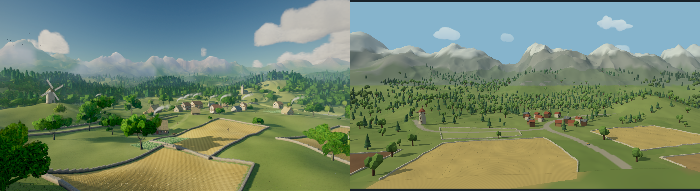
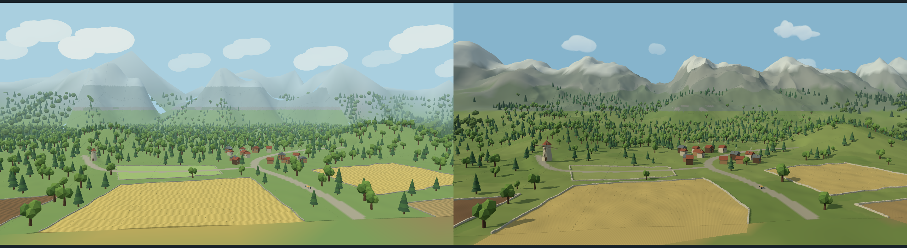

# Alpine Village 視覚品質改善

## 基準と再現方法

開始時のローカルHEADとリモート`feat/alpine-village-world`はともに`13968cccb69e85cbb00f63f0c66e7729260a130a`。作業ツリーはクリーンだった。改修は`feat/alpine-village-visual-upgrade`で行った。新しいワールドや外部サービスは追加していない。

```bash
pnpm sample-worlds:prepare
pnpm sample-worlds:validate
pnpm typecheck
pnpm test
pnpm build
PLAYWRIGHT_BROWSERS_PATH=/home/smorce/.cache/ms-playwright pnpm test:e2e
pnpm exec tsx scripts/alpine-village-evidence.ts
pnpm exec tsx scripts/alpine-village-visual-comparison.ts
pnpm exec tsx scripts/alpine-village-generation-identity.ts
```

Studioのサンプル一覧からAlpine Villageを選び「▶ あそぶ」で車を開始できる。ブラウザの証拠撮影は実際のStudio・Runtime・Three.js・Workerを使用しており、静的な別の景観レンダラーは使用していない。参考画像をテクスチャとして取り込む処理もない。

## 画像から判断した問題と変更

| 問題                           | 原因となった実装                                                                    | 改修                                                                                                                                                                                   |
| ------------------------------ | ----------------------------------------------------------------------------------- | -------------------------------------------------------------------------------------------------------------------------------------------------------------------------------------- |
| 巨大な独立した三角形の山       | `semantic.ts`の13峰の距離減衰と、64m間隔の遠景頂点                                  | `alpine-landscape.ts`に曲がった連続主稜線、前衛山脈、多尺度ノイズ、稜線の高さ変化を実装。遠景は16m間隔へ変更                                                                           |
| 森が均等な三角形と球の集合     | `world-generator/far-proxy.ts`の全域格子配置、近景の一定密度                        | 95mと38mの密度ノイズで群落と空き地を作り、山腹・山麓・村周辺・樹木限界を区別。近景と遠景は同じ密度関数を使用                                                                           |
| 麦畑が黄色い平面で反復が強い   | 頂点色の2m交互パターン、4mタイルに16本の短い麦                                      | 麦の区画を9〜10頂点の輪郭に変更。絶対座標のピクセル単位で境界と畝を描き、遠景の色補間によるぼけを減らす。麦は近景49本、中景9本、最遠1本のLOD                                           |
| 石垣が細い線、風車と村が小さい | 石垣の高さ約0.7m、風車の縮尺1、建物の縮尺0.95〜1.25                                 | 石垣の高さ・幅と白さを調整。風車の縮尺1.6、建物1.2〜1.45。家の正面を最寄りの道路へ向ける                                                                                               |
| 山のLOD境界から空が見える      | 同じ高さ関数でも64m遠景と2m近景の三角形補間が一致しない。下方の裾だけでは埋まらない | 遠景を細分化し、近景描画の外周を遠景の三角形補間に合わせ、内側3頂点分で滑らかに戻す。物理Bufferをコピーしてから描画用だけを変更                                                        |
| 色と光が平坦、遠景が消えかける | 強い環境光、濃い霞、単一の草色、無照明の雲                                          | Alpineだけ環境光2→1.1、日光2.1→2.8、時刻14→15.5、霞0.0008→0.00048。地表の色と低地の起伏に変化。雲を大小4群・40個の不均一な立体へ変更し、下面の明るい色と視線に応じた柔らかな輪郭を設定 |
| 全景で建物の影が見えにくい     | 通常の車周辺用48mのShadow Frustumが検査カメラの遠い注視点へ移動する                 | Alpineの編集・景観検査時だけ村と畑を覆う半幅220mの影範囲を使用。通常走行と既存ワールドの48mは維持                                                                                      |

森林では、樹高、樹冠幅、奥行き、色の種類、回転、控えめな傾きを変えている。遠景の針葉樹は3層の樹冠、広葉樹は3つの重なる樹冠へ変更し、2個のInstancedMeshを維持した。樹種の判定はSeedを使用する。高度が上がるほど針葉樹の比率が高まり、150m以上には樹木を置かない。近景の広葉樹は80mまでに制限する。

農地の地面は低周波の起伏に沿い、麦のタイルは傾斜に合わせて回転する。4m格子はChunk所有と決定性のため維持し、タイル内部の茎位置とタイルの位置に小さな揺らぎを入れた。畝の高周波成分は画面上の距離に応じて弱め、遠景の縞のちらつきを抑える。大量の個別Meshは追加していない。最終の性能調整で遠景の広葉樹の面数を削減し、区画の外ではシェーダーの境界判定を省く。また、麦の各茎は影を落とさず、村・樹木・石垣の影を優先する。

13の高い山の旧定義はWorld Designの互換性のため残すが、Alpineの高山の高さは専用の連続山脈関数で評価する。低い2つの丘、道路の高さ補正、村の平坦化は従来のSemantic Layersで評価する。この特例は`alpine-mainland`だけに適用する。

## 画像の比較

[参考画像と最終景観の横並び](alpine-village-upgrade/target-vs-upgrade.png)。左が参考、右が実ブラウザの最終版。同じ谷・村・左の風車・前景の畑という構成へカメラを合わせた。参考画像の元カメラ情報は不明なので、投影の完全な一致を主張するものではない。



[改修前と最終版の同一カメラ比較](alpine-village-upgrade/before-vs-after.png)。元の`13968cc`も別worktreeで同じブラウザ・カメラから撮り直した。



| 比較対象         | 改修前→改修後                                              |
| ---------------- | ---------------------------------------------------------- |
| 既存の全景カメラ | [overview](alpine-village-upgrade/overview-comparison.png) |
| 農地の近景       | [farmland](alpine-village-upgrade/farmland-comparison.png) |
| 森林と山脈       | [forest](alpine-village-upgrade/forest-comparison.png)     |
| 村               | [village](alpine-village-upgrade/village-comparison.png)   |
| 風車             | [windmill](alpine-village-upgrade/windmill-comparison.png) |
| 鳥瞰             | [aerial](alpine-village-upgrade/aerial-comparison.png)     |

証拠の保存場所:

- `alpine-village-upgrade/before/`: 依頼時の既存画像・性能JSONを保全。
- `alpine-village-upgrade/baseline/`: 元のHEADを同環境で再撮影・再計測。
- `alpine-village-upgrade/phase1/`: 山脈・森林を変更した最初の実ブラウザ画像。接続部の隙間を発見した段階。
- `alpine-village-upgrade/phase2/`: 遠景の細分化、農地・麦・石垣・風車を変更した画像。微小なLOD隙間がまだ残る中間版。
- `alpine-village-upgrade/phase3/`: 接続部の調整、建物の向き・縮尺、低地の起伏、照明・霞・雲を反映した最終画像。
- `alpine-village-upgrade/phase3-candidate/`: 雲の陰影が岩のように見えた棄却候補。全E2Eの実行を中断し、修正後に全件を再実行した。
- `alpine-village-upgrade/regression/`: 最終全E2Eによる既存8ワールドの画像。
- `alpine-village-upgrade/validation/`: 最終コマンドのログ。

中間画像を完成品として扱わず、画像で判明した問題を次の段階で修正した。`reference`カメラは位置`[-85,68,290]`、注視点`[-20,40,-340]`。既存の`overview`など6カメラは維持し、カメラ変更だけによる改善ではないことも確認できる。

## 変更ファイルと影響範囲

- `packages/world-generator/src/alpine-landscape.ts`: 高さ・密度・ノイズのAlpine専用関数。
- `semantic.ts` / `design-generation.ts` / `far-proxy.ts` / `settlement-generation.ts`: 共通関数の利用とAlpine限定の配置・向き・遠景解像度。
- `alpine-farmland.ts`: 区画の輪郭と地表色。
- `packages/sample-worlds/src/alpine-village.ts` / `builders.ts`: 森の高度、建物・風車・石垣の縮尺、空・光・霞。
- `packages/renderer-three/src/alpine-surface.ts`: Chunk原点に依存しない区画・畝の描画。
- `alpine-terrain.ts` / `index.ts`: 描画外周の補間、Alpine限定の光・影設定。
- `renderer-three/src/far-proxy.ts` / `alpine-atmosphere.ts`: 樹冠のシルエットと輪郭を薄くした立体的な雲。
- `packages/ai-dummy/src/alpine-models.ts`: 麦の密度・穂・茎、石垣の色。
- `demos/worlds/alpine-village.json` / `demos/sample-worlds/library.json` / 内容ハッシュ付き素材: 上記コードから再生成。
- `tests/unit/alpine-village.test.ts`: 高さの有限性・境界連続性・遠景の一致・森林密度・描画と物理の分離を追加。
- `tests/e2e/alpine-village.spec.ts`: 参考構図のカメラを追加。
- `scripts/alpine-village-visual-comparison.ts`: 比較PNGを再現可能に生成。
- `scripts/alpine-village-generation-identity.ts`: 山・森林・村・農地を含む固定64 Chunkの全生成値をハッシュ化。

Schema、Rapier、車両の力計算、道路の制御点、Origin Rebaseの閾値、Chunk管理の仕様は変更していない。既存8ワールドのPrepared JSONはSHA-256テストで不変を確認する。描画設定のAlpine特例はWorldロード時に判定し、他ワールドの環境光を元の強さへ戻す。

## 検証結果

| 検証                       | 結果                                                                                    | 証跡                                                                                                                                                                      |
| -------------------------- | --------------------------------------------------------------------------------------- | ------------------------------------------------------------------------------------------------------------------------------------------------------------------------- |
| 型チェック                 | 成功                                                                                    | [typecheck.log](alpine-village-upgrade/validation/typecheck.log)                                                                                                          |
| Unit／Integration          | 48ファイル、372件成功                                                                   | [test.log](alpine-village-upgrade/validation/test.log)                                                                                                                    |
| Build                      | Studio・Player・Server成功                                                              | [build.log](alpine-village-upgrade/validation/build.log)                                                                                                                  |
| Sample Prepare             | 9ワールド、59素材を生成                                                                 | [prepare.log](alpine-village-upgrade/validation/prepare.log)                                                                                                              |
| Sample Validate            | 全9ワールド成功                                                                         | [validate.log](alpine-village-upgrade/validation/validate.log)                                                                                                            |
| 全E2E                      | 49件すべて成功（16.4分）                                                                | [e2e.log](alpine-village-upgrade/validation/e2e.log)                                                                                                                      |
| 変更したTypeScriptのESLint | 成功                                                                                    | [lint.log](alpine-village-upgrade/validation/lint.log)                                                                                                                    |
| Chunk境界                  | 隣接Chunkの高さが同値。近景外周の描画接続も検証                                         | Alpine Unitと実写                                                                                                                                                         |
| Origin Rebase              | Alpineの実ブラウザ走行で1回。描画風車の絶対位置が前後で一致                             | [rebase.json](alpine-village-upgrade/phase3/rebase.json)、[直前](alpine-village-upgrade/phase3/before-rebase.png)、[直後](alpine-village-upgrade/phase3/after-rebase.png) |
| 再読込                     | Seed生成と再ロードの一致、再描画を確認                                                  | [reloaded.png](alpine-village-upgrade/phase3/reloaded.png)                                                                                                                |
| 既存8ワールド              | Prepared JSONのSHA-256一致、全E2Eの選択・接地・描画、車・船・飛行・レースの既存シナリオ | [回帰画像](alpine-village-upgrade/regression/)                                                                                                                            |
| リソース解放               | 煙・雲・遠景・インスタンスのdispose経路を確認                                           | Unit／既存E2E                                                                                                                                                             |

最終の全49件とは別に、道路色・ノイズ計算の仕上げ前にも全49件が一括成功している。そのログは[phase4-first-run](alpine-village-upgrade/phase4-first-run/e2e.log)へ保存した。雲の棄却候補では全件を中断したため、その実行は完了の証拠として数えていない。

初回の371件検証では、麦の微小な位置揺らぎによって既存のRebase完全一致テストが約`3e-14m`の浮動小数点差で失敗した。実際の位置ずれではなく、往復加減算の丸め誤差だった。絶対座標の往復比較を小数10桁の許容誤差へ変更し、371件すべてが成功した。後にキャッシュの上限・値の一致を追加し、最終の372件が成功した。

ブラウザE2Eと並行したUnit実行では、既存の50ms時間予算テストがCPU負荷で1件失敗した（2 Chunkを期待し1 Chunkで期限に達した）。製品の時間予算を緩める変更は行わず、ブラウザ終了後に全Unit／Integrationを一括再実行して成功を確認した。

## 性能と仕上げ時の修正

描画負荷を抑えるため、樹木を均等に増やす方法は採らなかった。遠景の森林は2バッチのまま維持し、最終版では樹冠の面数、麦のLOD、麦のShadow Map再描画を減らした。地形サンプラーが所有する最大32,768値のノイズキャッシュも加え、影響がゼロの村・農地周辺では高山の計算を省く。グローバルに無制限なキャッシュを残す方式ではない。

単独のNode計測で、仕上げ前のChunk生成中央値24.48msから、ノイズ値の再利用と早期終了によって8.50msへ短縮した。固定64 Chunkの全生成値のSHA-256は改修前後で一致し、地形・色・配置は変わっていない。[generation-identity.json](alpine-village-upgrade/generation-identity.json)と再現スクリプトで確認できる。

画像の再確認で、畑のシェーダーが草地区画内の道路色も上書きしていたことを見つけ、元の頂点色の道路成分を残すよう修正した。道路の位置・幅・物理地形は変更していない。

| 画面       | Draw Call：前→後 |     三角形：前→後 | RAF中央値ms：前→後 |
| ---------- | ---------------: | ----------------: | -----------------: |
| 開始直後   |        152 → 124 | 266,826 → 382,940 |      133.3 → 183.3 |
| 参考構図   |        405 → 338 | 523,242 → 500,360 |      250.0 → 283.3 |
| 既存全景   |        595 → 522 | 703,590 → 691,390 |      300.0 → 383.3 |
| 村         |        414 → 374 | 541,984 → 578,398 |      233.3 → 316.6 |
| 農地       |        301 → 275 | 483,910 → 687,424 |      233.3 → 333.4 |
| 鳥瞰       |        500 → 423 | 608,180 → 593,008 |      233.3 → 283.3 |
| 風車       |        194 → 170 | 305,366 → 328,754 |      183.3 → 233.3 |
| 森林       |        199 → 174 | 304,144 → 326,616 |      150.0 → 199.9 |
| 短時間走行 |        215 → 197 | 318,762 → 347,812 |      166.7 → 216.6 |

Chunk生成（同じ100座標、実ブラウザ検証終了後のNode単独計測）は中央値 7.02 → 8.12ms、p95 12.55 → 23.05ms。開始直後の生成完了時間や、フレーム内のMain Thread時間を表すものではない。

参考構図ではDraw Callが405→338、三角形が523,242→500,360へ減ったが、RAF中央値は250.0→283.3msへ増えた。農地の近景では三角形とフレーム時間も増えている。地形の細分化、麦の立体表現、広い影範囲、ピクセル単位の畝、半透明の雲のコストが残る。性能が一様に改善したとは報告しない。

再読込後のJS Heap瞬間値は約132.0→222.3MB。GCのタイミングを揃えた比較ではなく、増加をリークとも解放済みとも断定しない。長時間のメモリ追跡と実GPUでの性能検証は残る。

[performance-comparison.json](alpine-village-upgrade/performance-comparison.json)には同じカメラ・Chromium・DPRの中央値、元の各[baseline](alpine-village-upgrade/baseline/performance-summary.json)／[phase3](alpine-village-upgrade/phase3/performance-summary.json)には中央値・p95・最大値・サンプル数を保存する。`renderMs`はCPUの描画送信時間で、RAFはソフトウェア描画やスケジューリングを含む。1画面の採取窓は2秒で、単一実行のため統計的な優位性を主張しない。JS HeapはGCを強制しない瞬間値であり、VRAMやリークの証拠ではない。

## 制約と残る差

- 参考の密な枝葉、草の細かな表面、土や建物の写実的な材質までは再現していない。木や建物は既存の手続きモデルを使うため、近景に低ポリゴンの形が見える。
- 区画は折れ点を増やした多角形で、厳密な曲線の農地境界ではない。残る3区画は従来の輪郭を維持した。
- 麦の近景・中景のLOD切替で、密度の変化が分かる場面が残る。
- 遠景と近景の森林は同じ密度分布を使うが、個々の木の座標・シルエットは同一ではなく、Chunk切替で樹冠の見え方が変わり得る。
- 麦の4m格子は所有Chunkを安定させるため残る。密度を上げ、揺らぎを入れて反復を弱めたが、至近距離では畝と配置規則を識別できる。
- 雲は下面と上面の色を頂点へ設定した半透明の立体の集合であり、ボリューム散乱や柔らかな半透明の雲を実装したものではない。
- 主稜線と前衛の丘は連続するが、実地形の侵食シミュレーションは行っていない。
- 高山のLOD接続部には法線・色の補間による見え方の差が残る。
- 近景の描画外周は遠景の補間へ合わせるため、物理の高さと微小な差を持ち得る。山の急斜面では差が大きくなる場合がある。運転する道路と村の高さ補正・物理地形は維持している。
- 実ブラウザのAlpine車両は開始点から道路に沿ってRebaseまで走行した。集落内の全ての曲がり方や、畑の内部での走行を網羅したものではない。
- リソース解放は煙・雲・遠景・インスタンスのdisposeと既存のテスト経路で確認する。長時間にわたる実GPUのVRAM追跡や反復ロードのリーク測定は未実施。
- ブラウザはChromium / ANGLE SwiftShaderのソフトウェア描画。実GPU、モバイル、Firefox、WebKitの今回の景観品質・性能は未検証。FPSを実GPUの数値へ換算しない。
